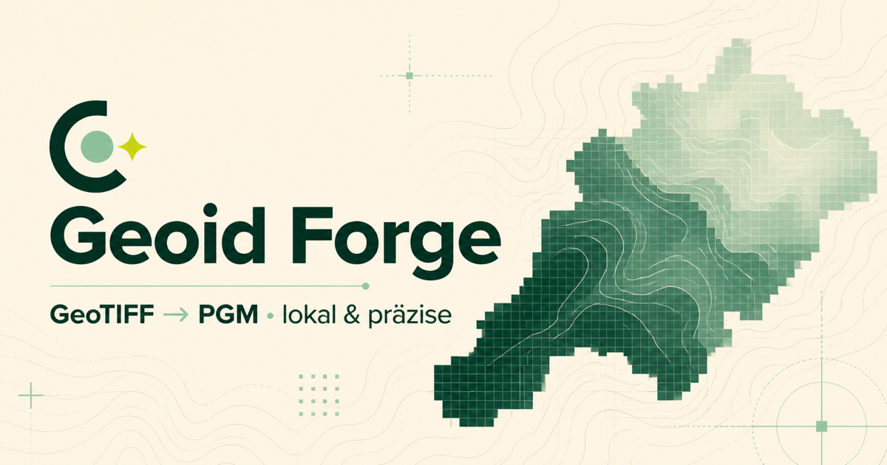

# Geoid Forge

Aktuelle App-Version: **v26.08.3.0**



Eine browserbasierte Single-Page-App zum Analysieren von GeoTIFF-Geoidmodellen und zum Exportieren als binäres 16-Bit-PGM. Die Quelldatei bleibt im Browser und wird nicht auf einen Server hochgeladen.

## Funktionen

- GeoTIFF-Analyse mit Rastergröße, Datentyp, Kompression und GeoKeys
- CRS-Erkennung und Transformation für die Kartenanzeige
- Footprint aus gültigen Rasterzellen statt nur einer Bounding Box
- Höhenstatistik inklusive NoData-Anteil
- Binärer P5-Export mit Big-Endian-16-Bit-Werten
- RayStudio-Preset mit `Offset -108` und `Scale 0.003`
- NoData-Füllung über den nächsten gültigen Rasterwert oder den Median
- Umschaltbares helles/dunkles Interface und vollständige deutsche/englische Oberfläche
- App-Verweise auf PointCloud Manager, GPS2UTM und Geodata Inspector & Cleaner
- Verweise auf Impressum und Ko-fi
- Hilfe-, Bugreport- und Kontaktformular über Netlify Forms
- Vollständig statischer Netlify-Build

## Versionierung

Geoid Forge folgt wie SkyCheck und PointCloud Manager dem Schema `vYY.MM.major.subversion`. Ein neuer Funktionsstand erhöht `major` und setzt `subversion` auf `0`; reine Fixes erhöhen die letzte Stelle. Die vollständige Versionsnummer steht zentral in `app/lib/version.ts` und wird im Browser-Titel sowie im Footer angezeigt.

## Lokal starten

```bash
npm install
npm run dev
```

Die App läuft anschließend unter `http://localhost:3000`.

## Netlify-Build

```bash
npm run build:netlify
```

Der statische Export wird in `out/` erzeugt. Die Build- und Publish-Einstellungen stehen in `netlify.toml`.

## Format-Hinweis

Der Export folgt dem Netpbm-P5-Format. GeographicLib verwendet für Geoid-PGM-Dateien die Beziehung `Höhe = Offset + Scale × Pixelwert`. GeographicLib selbst erwartet dabei weltweite Raster. Für regionale Modelle wie GCG2016/2023 sollte ein RayStudio-Import deshalb an einem bekannten Kontrollpunkt validiert werden, solange RayStudio kein öffentlich dokumentiertes regionales PGM-Schema bereitstellt.

## Technische Grundlagen

- [Netpbm PGM specification](https://netpbm.sourceforge.net/doc/pgm.html)
- [GeographicLib geoid data format](https://geographiclib.sourceforge.io/C++/doc/geoid.html#geoidformat)
- [geotiff.js](https://github.com/geotiffjs/geotiff.js)
- [Proj4js](https://github.com/proj4js/proj4js)
- [BKG GCG2016/2023](https://gdz.bkg.bund.de/index.php/default/quasigeoid-der-bundesrepublik-deutschland-quasigeoid.html)
